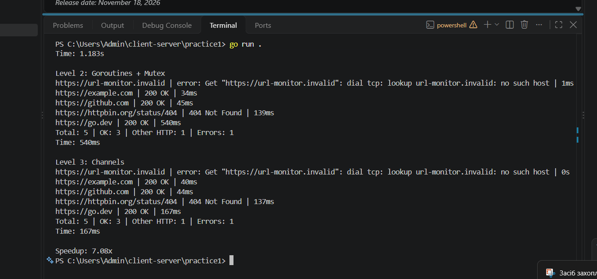
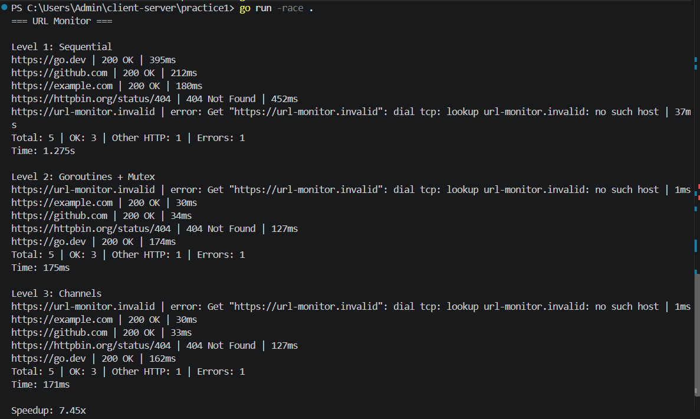
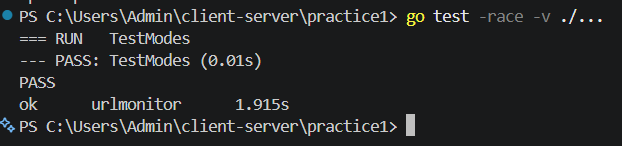

# Практична робота №1

**Тема:** Базові конструкції, структури даних та конкурентність у Go.

## Мета роботи

Ознайомитися зі структурами, методами та інтерфейсами мови Go. Навчитися використовувати горутини, механізми синхронізації та канали для конкурентного виконання завдань.

## Хід виконання роботи

### Рівень 1. Послідовний моніторинг

Розроблено консольну програму для перевірки доступності HTTP-ресурсів. Створено структуру результату, інтерфейс перевірки та HTTP-клієнт. Для кожної адреси визначається статус відповіді, тривалість запиту та наявність помилок.

### Рівень 2. Горутини та Mutex

Реалізовано конкурентну перевірку адрес за допомогою горутин. Для очікування завершення запитів використано sync.WaitGroup, а для захисту спільної статистики — sync.Mutex.

### Рівень 3. Асинхронний збір результатів

Реалізовано передачу результатів через канали. Після завершення всіх запитів канал закривається, формується підсумкова статистика та визначається прискорення конкурентного виконання.

## Запуск програми

Для запуску необхідно виконати команду:

```bash
go run .
```



## Перевірка конкурентності

```bash
go run -race .
```

Під час виконання програми станів гонитви даних не виявлено.



## Тестування

```bash
go test -race -v ./...
```

Автоматичне тестування пройшло успішно.



## Порівняння результатів

| Режим виконання | Час |
|---|---:|
| Послідовний | 1,275 с |
| Горутини та Mutex | 175 мс |
| Горутини та канали | 171 мс |

Прискорення конкурентного виконання становить 7,45 раза за результатами запуску з прапорцем -race.

## Висновок

Під час виконання практичної роботи було освоєно основні засоби конкурентності мови Go. Реалізовано три способи перевірки HTTP-ресурсів та встановлено, що конкурентний підхід дозволяє суттєво скоротити час виконання запитів.