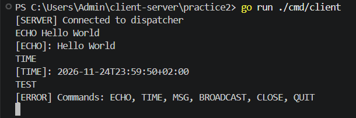
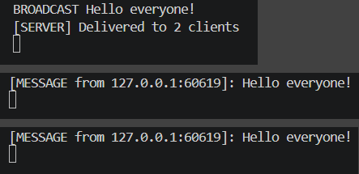
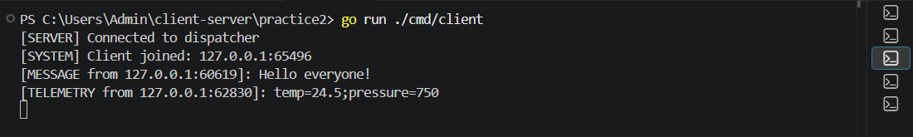
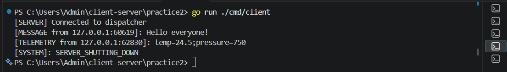
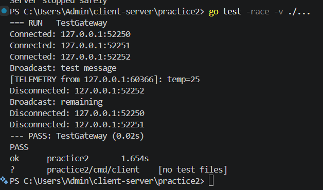

# Практична робота №2

**Тема:** Сокетне програмування та обмін повідомленнями по TCP/UDP.

## Мета роботи

Опанувати роботу з мережевими сокетами Go, конкурентне обслуговування клієнтів, широкомовну розсилку та приймання UDP-телеметрії.

## Хід виконання роботи

### Рівень 1. TCP-сервер команд

Створено сервер на порту 9000. Кожне підключення обробляється окремою горутиною. Команди читаються до символу нового рядка.

| Команда | Призначення |
|---|---|
| `ECHO hello` | Повернення тексту |
| `TIME` | Час сервера у форматі RFC3339 |
| `QUIT` або `CLOSE` | Завершення з'єднання |
| `UNKNOWN` | Повідомлення про невідому команду |
| `BROADCAST hello` або `MSG hello` | Розсилка іншим клієнтам |

### Рівень 2. Реєстрація клієнтів та Broadcast

Активні підключення зберігаються у map під захистом sync.Mutex. Сервер повідомляє про підключення та відключення клієнтів і передає повідомлення всім учасникам, крім відправника.

### Рівень 3. UDP та Graceful Shutdown

UDP-сокет на порту 9001 приймає телеметрію та передає її TCP-клієнтам. При натисканні Ctrl+C сервер сповіщає клієнтів, закриває сокети та очікує завершення горутин через sync.WaitGroup.

## Запуск та перевірка

У першому терміналі запустити сервер:

```powershell
go run -race .
```

У трьох інших терміналах запустити по одному клієнту:

```powershell
go run ./cmd/client
```

У клієнті перевірити команди `ECHO hello`, `TIME`, `UNKNOWN` та `BROADCAST hello`.





В окремому терміналі надіслати UDP-датаграму:

```powershell
go run ./cmd/client -udp "temp=24.5;pressure=750"
```



Для завершення сервера натиснути Ctrl+C у його терміналі.



## Тестування

```powershell
go test -race -v ./...
```



## Висновок

Розроблено мережевий сервіс із підтримкою TCP та UDP, конкурентним обслуговуванням клієнтів і безпечним завершенням роботи. Реалізовано текстовий протокол команд та обмін повідомленнями між підключеними клієнтами.
